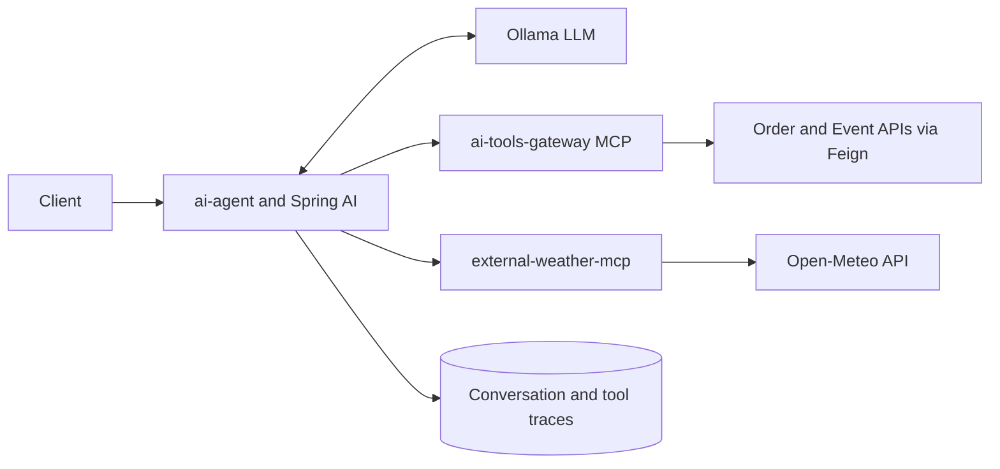

# ticket-manager

## Prerequisites

This repository currently does not include a Maven Wrapper. Install Maven locally and run Maven commands from the `ticket-manager` project directory, where the parent `pom.xml` is located.

Required local tools:

- Java 17 or newer.
- Maven 3.9 or newer.
- Docker, for the local infrastructure defined in `ticket-manager/docker-compose.yml`.

Ticket Manager is a distributed microservice system for managing events and ticketing. Each microservice runs as an independent application built on Java 17 and Spring Boot, which allows for clear separation of responsibilities, independent implementation, and easy scaling depending on needs.

## AI runtime: the model answers, the application stays in control

The Ollama LLM interprets the request, chooses only from tools approved for the current caller, and generates the final answer. It never calls a database or microservice directly. Java and Spring AI own the runtime: JWT context, conversation memory, read-only tool policy, MCP execution, error handling, and PostgreSQL audit traces.

| Component | Role |
| --- | --- |
| `ai-agent` (`8099`) | Controls memory, tool allow-list and scopes, the Spring AI tool loop, and execution records. |
| `ai-tools-gateway` (`8105`) | Internal MCP server exposing `tm_my_orders_search` and `tm_events_search`; real handlers reach domain APIs through OpenFeign, while fake handlers support isolated runs. |
| `external-weather-mcp` (`8110`) | External Node.js/TypeScript MCP provider connecting weather tools to Open-Meteo. |
| `knowledge-service` (`8111`) | RAG foundation under development, with Ollama embeddings and PostgreSQL/pgvector. It is not yet in the answer path. |

**The model may request a tool call, but only the application can authorize, execute, and record it.**

The system architecture is based on several key pillars:

**Communication and integration** The system uses a hybrid architecture, combining synchronous REST communication with asynchronous message exchange.

Spring Web is used to share and consume REST APIs between microservices. OpenFeign is used to create an HTTP client between services, which allows declaratively defining calls to other services.

In cases where loose dependency and tolerance to errors and delays are required, RabbitMQ is used as a message broker. Events such as ticket reservations are sent to other services, for example Notification Service, via message queues.

**API Gateway and security** All external requests first go to the API Gateway, built on the Spring Cloud Gateway. It is responsible for:

- routing requests to the appropriate microservices,
- validating and verifying JWT tokens,
- simplifying communication with the frontend as one entry point to many services.

Keycloak is responsible for authentication and authorization - an external identity server that supports user login, account management, and role assignment such as USER and ADMIN. Authentication is based on JWT tokens, which are checked by the gateway and microservices using Spring Security.

The security model is based on RBAC - Role-Based Access Control - which allows for precise control of access to resources depending on the user's permissions.

**Data layer and versioning** Each microservice has its own isolated database, in accordance with the Database per service principle. The system uses PostgreSQL as a relational database engine, and access to data is provided using Spring Data JPA.

Changes to the database structure are managed using Liquibase, which enables:

- automatic versioning of the database schema,
- performing migrations at service startup,
- consistent control of the history of changes in the database.

**Containerization and launching** All system components - microservices, RabbitMQ, Keycloak, and databases - are launched and managed in Docker containers, which provides a repeatable and easy-to-configure runtime environment. This facilitates local launch, testing, and implementation of the system in various environments.

**Observability and monitoring** To monitor system operation and track request flow, the following were used:

- Spring Cloud Sleuth - automatic labeling of requests with unique identifiers such as traceId and spanId,
- Zipkin - distributed tracing enabling analysis of processing time and localization of problems in the service chain.

Microservice logs are also prepared for integration with tools such as ELK Stack, which allows for their central analysis and searching.

**Testing** The project has been covered with unit and integration tests using:

- JUnit 5 and Spring Test - for testing components within the application,
- Testcontainers - for running temporary containers with PostgreSQL or RabbitMQ in integration tests, which allows testing microservices in an isolated and realistic environment.

**API documentation** Each microservice automatically generates documentation for its REST API using Swagger / OpenAPI with Springdoc. The interface is available at the `/swagger-ui.html` endpoint and allows for easy testing and viewing of the API structure.

**Sample order process**

